<h1 align="center">The Asymmetric Cost of State-of-Charge Error in Regenerative Braking</h1> 
<b>Lithium-plating risk in a 96-cell EV pack, and an uncertainty-aware charge limit (ROBUST-A)</b>
 
      
 
 <a href="docs/ED5361_IEEE_Report.pdf"><b>📄 Paper (IEEE, 9 pages)</b></a> &nbsp;·&nbsp; <a href="docs/ED5361_Presentation.pdf"><b>📊 Slides</b></a> &nbsp;·&nbsp; <a href="#8-how-to-run"><b>▶️ Run it</b></a> 
 
<i>Course project, ED5361 Energy Storage and Conversion Systems, Department of Engineering Design, IIT Madras · November 2026</i>

At a glance
<table> <tr> <td align="center"><h3>10 % → 87 %</h3>regen lost when the SoC estimate reads <b>+2 % → +5 %</b> high near full</td> <td align="center"><h3>4–9 mV</h3>plating margin left even with a <b>perfect</b> SoC estimate</td> <td align="center"><h3>59–60 of 60</h3>packs plate their weakest cell under a standard limit, <b>with a perfect SoC</b></td> <td align="center"><h3>0.5 %</h3>trips breached by <b>ROBUST-A</b> on 600 unseen trips, keeping <b>87 %</b> of ideal regen</td> </tr> </table>
Contents
The problem
Our approach: truth vs belief
The models
Limit policies and ROBUST-A
Experiments
Results
Is the model right? Verification
How to run
Repository layout
Team
Limitations
References
1. The problem

When an electric car brakes, the motor works as a generator and charges the battery: regenerative braking ("regen"). Every 0.2 s the battery management system (BMS) decides how much charging current the battery may accept, and the rest goes to the friction brakes as heat.

Two of the BMS's limits cannot be measured:

Lithium plating: if the graphite anode potential falls below 0 V vs Li/Li⁺, metallic lithium coats the anode. This is permanent damage, most likely when the cell is cold, nearly full or charged hard, which is exactly the situation of hard braking at high charge.
The 97 % state-of-charge ceiling of the usable window.

Both depend on the true state of charge (SoC), but the BMS only has an estimate. So the error cuts both ways:

The SoC estimate reads…	What the BMS does	What it costs
🔼 too high	stops regen early	energy, lost to the friction brakes
🔽 too low	allows too much current	safety: plating or overfilling

[!IMPORTANT] SoC estimators are usually judged by a single ± accuracy figure. We show the two directions cost different kinds of things, measure both on a physics-based cell in a full pack, and design a limit that stays safe.

Research gap. Earlier work studies SoC estimation, plating-aware charge limits and cell-to-cell variation separately. No study joins all three during regenerative braking.

2. Our approach: truth vs belief

We built a simulator in MATLAB that keeps the truth (96 physics-based cells) separate from the belief (what the BMS estimates). Every BMS decision can then be scored, and each trip can be repeated with an all-knowing reference controller (ORACLE) to measure the best possible regen.

 
Every 0.2 s the vehicle offers regen power, the BMS sets a current limit from noisy sensors, and the 96 true cells respond. The BMS never sees the true SoC or anode potential.

3. The models
3.1 Vehicle (core/vehicle_step.m)

A 1,650 kg compact EV with a 96-cell, 86 Ah pack (about 30 kWh). It uses a backward-facing model: the speed trace is known, so the force follows directly.

$$F = m(1+\delta)\,a + \tfrac{1}{2}\rho C_dA\,v^2 + mgC_{rr}\cos\theta + mg\sin\theta$$

After 3 % gear loss, a 60 kW regen cap and 8 % motor loss, at most 55 kW reaches the battery. A hard stop from 80 km/h needs 107 kW, so almost half goes to the friction brakes anyway. Three driving patterns each stress a different limit:

Pattern	What it is	What it stresses
Hard stops	5 × (0 → 80 km/h → stop)	plating: short bursts up to 55 kW
MIDC	official Indian city cycle, 10.5 km	ordinary driving: low power
Ghat descent	12 km at 40 km/h on a −6 % slope	the 97 % ceiling: 7.4 kW for 18 min, 2.25 kWh

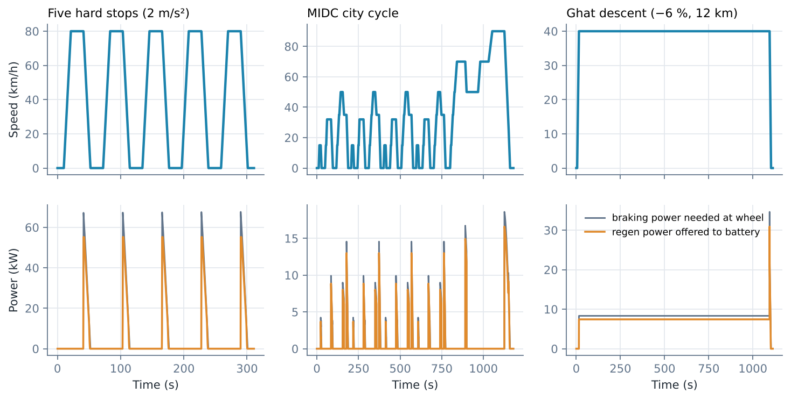

3.2 Battery cell (core/cell_step.m)

Plating is decided by the anode potential, which a simple circuit model cannot provide. We use the published LG M50 cell (Chen et al. 2020, temperature laws from O'Kane et al. 2022). The full Doyle–Fuller–Newman model in PyBaMM is too slow for about 12,000 trips × 96 cells, so we reduced it to one particle per electrode with diffusion, Butler–Volmer kinetics and two fitted corrections, then scaled it to 86 Ah.

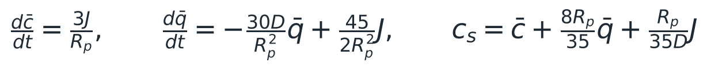  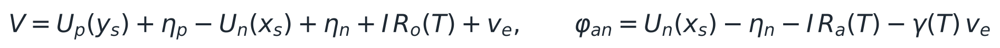

On drive profiles it was never fitted to, the reduced model matches the DFN's lowest anode potential within 3.4 mV:

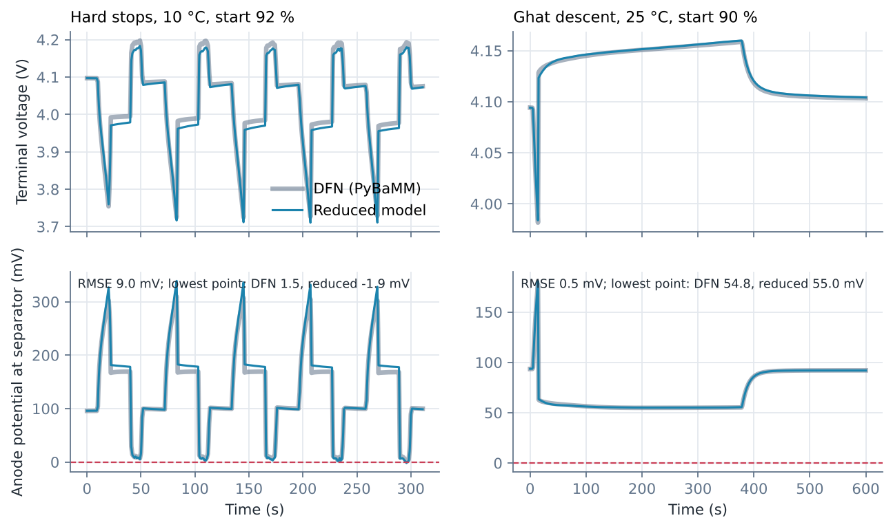

3.3 Pack (core/pack_sample.m)

The pack is 96 cells in series that all carry the same current, but no two cells are identical. Each cell gets a random spread (1σ): capacity 1 %, resistance 4 %, kinetics 8 %, SoC 1 %, temperature 1.5 K. The weakest cell plates first, and the BMS cannot see which one it is: it has only one temperature sensor per 12 cells.

3.4 BMS (core/ekf_step_v2.m, core/plating_limit_v2.m)
Estimator: an extended Kalman filter on a 2RC circuit model. Because the circuit model is not the true cell, the estimation errors arise realistically: about 1 % when warm and about 3.5 % in the cold.
Charge limit: the smallest of four limits over the next 10 s.
$$I_{\lim} = \min\big(\,I_{\text{hw}},\; I_V,\; I_{\text{ceil}},\; I_{\text{pl}}\,\big)$$

The 97 % ceiling and plating limits are computed from the estimated SoC. That is exactly where estimation error enters every regen decision.

4. Limit policies and ROBUST-A

A policy decides which SoC value (and which plating check) goes into those limits. Everything else is identical.

Policy	SoC fed to the limits	Plating check	Origin
SOP	estimate $\hat z$	nominal cell, 0 mV	standard state of power (Plett 2004)
SOPM	$\hat z$	nominal cell, +10 mV	industry-style fixed margin
ROBUST	$\hat z + 2(\sigma + 0.01)$	nominal cell	k-sigma SoC margin
LEANHIGH	$\hat z + 0.02$	nominal cell	simple bias
ORACLE	true SoC of every cell	every cell	reference only
ROBUST-A	below	worst cell	this work

Why the others fail. Plating has three causes. Each standard limit fixes at most one, and ROBUST-A adds one protection for each:

Cause	ROBUST-A's fix
The SoC estimate reads low, and the filter can be overconfident	Adaptive SoC margin, inflated by the filter's own consistency check (NIS)
The fullest cell is ahead of the average	Key-on imbalance check from the cell-voltage spread at start-up
The weakest cell plates, even with a perfect SoC	Worst-cell plating limit, about 2.5σ below nominal (roughly the worst of 96 cells)
$$z_p = \hat z + k_A\Big(\sigma\sqrt{\max(\text{NIS},1)} + \sigma_m\Big) + \Delta z_{\text{key}}, \qquad k_A = 3,\ \sigma_m = 0.01$$
$$\phi_{\text{worst}} = \phi_{\text{nom}} - k_c\sqrt{\textstyle\sum_i d_i^2}, \qquad k_c = 2.5$$

The limit is the largest current that keeps $\phi_{\text{worst}} \ge 0$ mV for the next 10 s.

[!NOTE] ROBUST-A needs no extra sensors. It uses information a real BMS already has: the Kalman filter's innovations, the cell voltages at key-on, and factory spread data. Its one tuning number, $k_A$, was chosen on training trips and then frozen.

5. Experiments
Block	Question	What varies
X0 Maps	Where is the safe current lowest?	SoC (30–97 %) × temperature
X1 Accuracy	Is reading high as bad as reading low?	bias ±10 % × start SoC × 4 temperatures (1,640 runs)
X2 Scenarios	Does the driving pattern matter?	bias × start SoC × 5 patterns × 3 temperatures
X3 Spread	What do unequal cells add?	perfect SoC; spread × 0–2 and one spread at a time (3,440 runs)
X4 Case study	What happens second by second?	one aged, cold pack with a bad initial estimate
X5 Monte Carlo	Is ROBUST-A safe on unseen trips?	600 training + 600 test trips × 6 policies
X6 One year	What does it mean in India?	X5 scaled to three Indian use patterns

Monte Carlo trips draw random temperature (5–40 °C), starting SoC (60–95 %), pack age (SoH 80–100 %), sensor errors and a new random pack. Every policy runs the same trips, so differences come from the policy alone.

6. Results
6.1 Why plating depends on SoC: the graphite step

The safe 10 s current drops by about 40 % between 60 % and 70 % SoC. Graphite fills in stages, and its potential steps down there. So accuracy matters near full and at 65–75 % SoC.

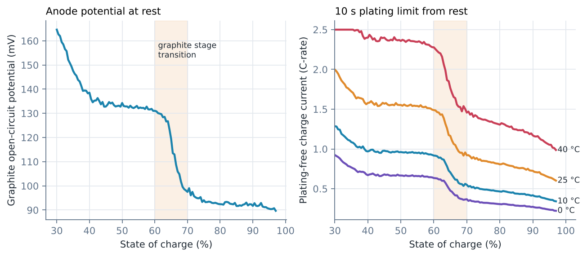

6.2 The cost of SoC error is lopsided

From 95 % SoC with hard stops at 25 °C, overestimates of +2 % and +5 % lose 10 % and 87 % of regen. Underestimates use up a plating margin of only 4–9 mV: from 70 % SoC, an estimate 3 % too low already plates.

6.3 The accuracy map

The largest SoC error that is tolerable by start SoC and temperature: two sensitive bands, and harmless below 60 %.

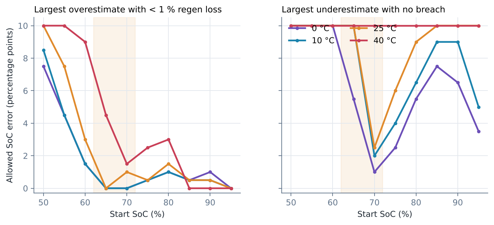

6.4 The driving pattern changes the cost

With the same +2 % error from 95 %, hard stops lose 6–10 % of regen and city driving almost nothing, but the ghat descent loses 81 %, because the long charge reaches the believed 97 % ceiling early. With an underestimate on the descent, the true SoC stays above 97 % for 6–12 minutes.

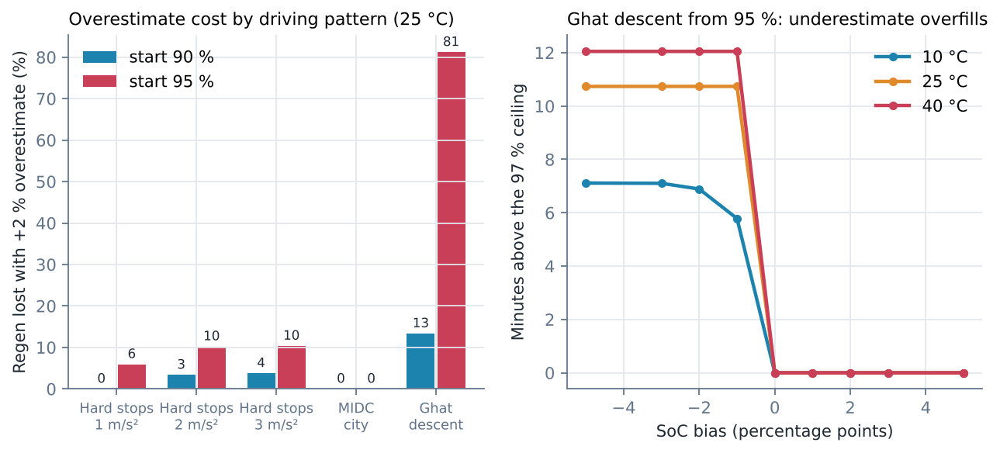

6.5 Unequal cells plate, even with a perfect SoC

We gave the BMS the true SoC, so there was no estimation error at all. Under the standard limit the weakest cell still plated in 60 of 60 packs at 10 °C and 59 of 60 at 25 °C. A fixed 10 mV margin cut this to 5 and 2; ROBUST-A brought it to 0. Anode kinetics and temperature spread matter most.

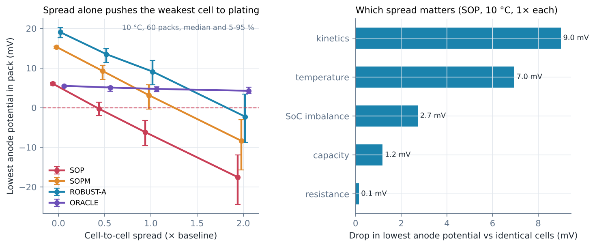

6.6 Our MATLAB runs: one pack, step by step

One cell on five hard stops (top), then one 96-cell pack at four temperatures and under five limits (bottom). Plating, not the motor, caps regen. Under SOP the pack plates at 0 °C (−6.8 mV) and 10 °C (−8.5 mV) and is safe at 25 and 40 °C. In the cold, ROBUST-A keeps the widest margin (+9.2 / +7.0 mV) and 91–93 % of ORACLE's regen.

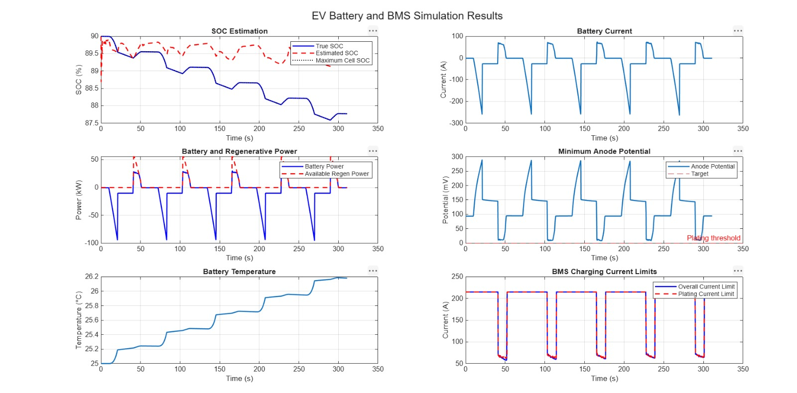
 <table> <tr> <td>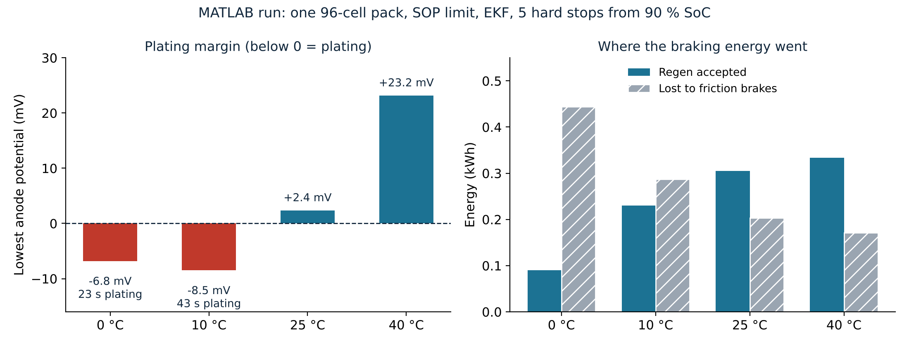</td> <td>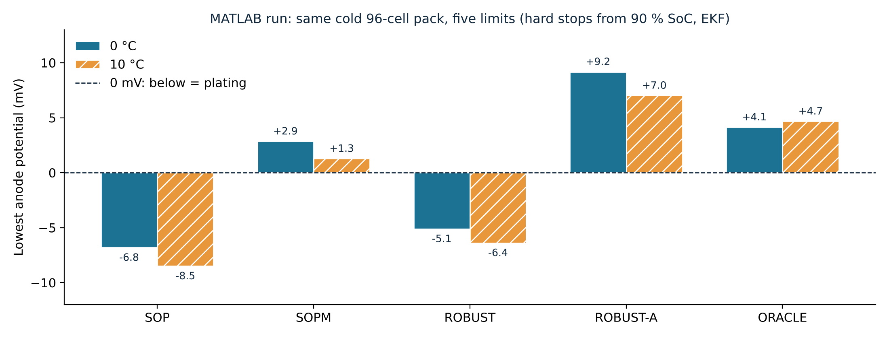</td> </tr> </table>

[!NOTE] These runs use one pack (seed 1), so they illustrate the mechanism. The rate of failure comes from the Monte Carlo test below.

6.7 Case study: an aged pack in the cold

The pack has SoH 85 %, starts at 5 °C and 85 % SoC, and its estimate begins 3 % low with a 0.5 A sensor offset. SOP plates on every stop and ROBUST for 21 s; ROBUST-A never plates (+8.0 mV) and keeps 95 % of ORACLE's regen.

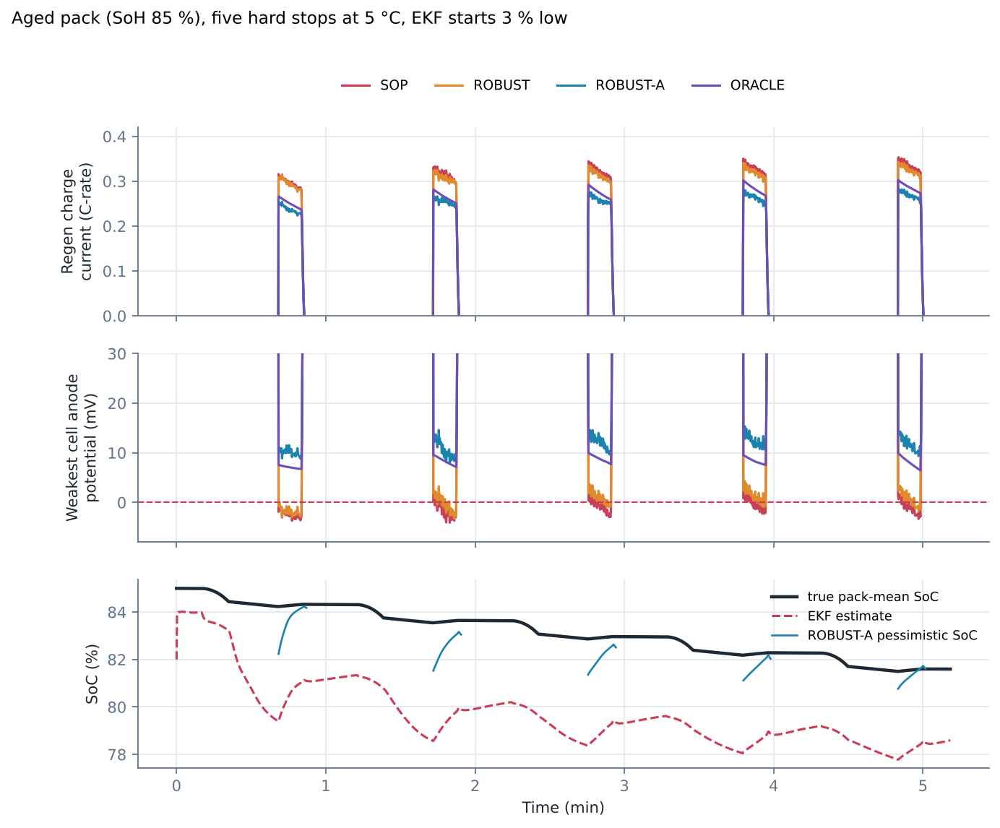

6.8 Monte Carlo: 600 unseen trips

$k_A = 3$ was the smallest value meeting a 1 % breach target on the training trips. It was then frozen and tested on 600 new trips.

Policy	Trips breached	95 % interval	Regen vs ORACLE
SOP (standard)	44.5 %	40.6–48.5 %	104 %*
ROBUST	34.5 %	30.8–38.4 %	101 %*
LEANHIGH	33.3 %	29.7–37.2 %	100 %*
SOPM (industry-style)	13.8 %	11.3–16.8 %	103 %*
ROBUST-A (ours)	0.5 %	0.2–1.5 %	87 %

*Above 100 % means energy accepted while a cell was plating. The intervals are 95 % Wilson intervals.

<table> <tr> <td width="50%"></td> <td width="50%">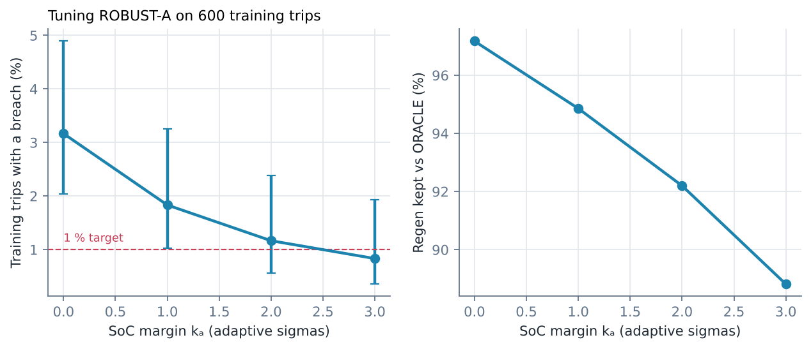</td> </tr> <tr> <td align="center">Safety vs energy on the test trips</td> <td align="center">Tuning kA on the training trips</td> </tr> </table>

All three of ROBUST-A's breaches were shallow (−1.4 to −2.4 mV), on cold, aged packs descending the ghat. 210 of SOP's 233 plating breaches started below 90 % SoC, so a fixed "cut regen above 90 %" rule would not have prevented them.

6.9 A year of driving in India
Use pattern	ROBUST-A's regen given up	Cost / year	Plating trips / year (SOP → ROBUST-A)
City commuter (12,000 km)	35 kWh	₹311	177 → 0
Hill route (8,000 km + 2 ghats/week)	48 kWh	₹426	156 → 1.6
Ride-hailing (45,000 km)	381 kWh	₹3,390	4,526 → 0

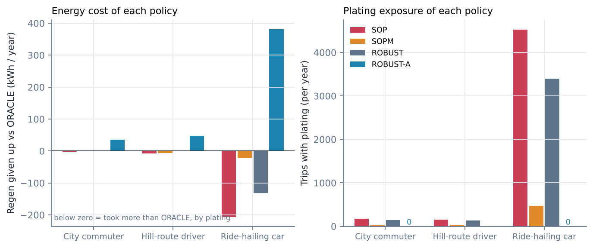

Assumes ₹8/kWh at 90 % charging efficiency, 13 kWh/100 km and 0.727 kg CO₂/kWh (CEA).

7. Is the model right? Verification

All nine automated checks pass (scripts/verify_v2.m → results/verify_v2.txt):

	Check	Result
V1	Charge balance	SoC equals the Coulomb count to 6 × 10⁻⁷
V2	MATLAB vs Python	anode potential within 0.042 mV
V3	Reduced model vs DFN	lowest φ within 3.4 mV on 4 unseen profiles
V4	Time step	regen at 0.2 s vs 0.05 s differs by 0.20 %
V5	ORACLE is safe	0 breaches in 120 pack runs
V6	Perfect-SoC single cell	0 of 9 SOP runs plate
V7	Monotone in bias	regen falls 0.320 → 0.038 kWh from −5 % to +5 %
V8	EKF converges	−0.19 % after one MIDC, starting from +3 %
V9	Energy balance	0.545 = 0.529 regen + 0.016 friction (kWh)
8. How to run

Requirements: MATLAB (no toolboxes needed) or GNU Octave 8+. For the figures, Python 3 with numpy, pandas and matplotlib. pybamm is needed only to regenerate the DFN reference data.

matlab
% from the repository folder
setup                                   % adds core/ and scripts/ to the path
cfg = default_cfg_v2();                 % default settings
cfg.N = 96;                             % a 96-cell pack
cfg.cycle = 'HILL';                     % 'HARDSTOP', 'MIDC' or 'HILL'
cfg.policy = 'ROBUSTA';                 % 'SOP','SOPM','ROBUST','LEANHIGH','ROBUSTA','ORACLE'
cfg.T_amb_C = 10;                       % ambient temperature (°C)
[M, L] = simulate_v2(cfg);              % M: trip totals, L: time series (if cfg.log = true)
disp([M.E_regen, M.phimin, M.t_plate])  % regen energy, lowest anode potential, seconds plating
% A 96-cell ghat trip takes about 3 minutes in GNU Octave.
To reproduce	Run	Output
The nine model checks	scripts/verify_v2.m	results/verify_v2.txt
Experiments X0–X5	scripts/exp_x0_maps.m … scripts/exp_x5_mc.m	results/X*.csv
Paper figures	python3 scripts/make_figures_v2.py	results/figures/
Our MATLAB demonstration runs	scripts/matlab_runs/*.m (MATLAB only)	CSV, MAT and PNG files in the current folder

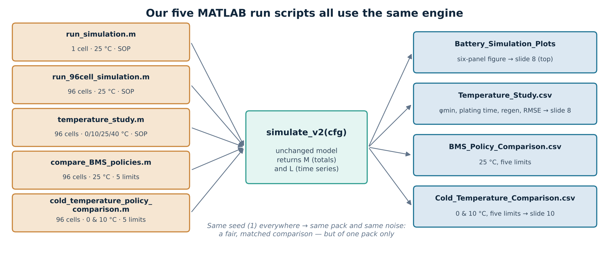

[!TIP] All saved results are already in results/, so you don't need to rerun anything to explore them. The Monte Carlo study (exp_x5_mc.m) takes by far the longest.

9. Repository layout
text
├── core/                 the model: vehicle, cell, pack, BMS, policies, main loop (simulate_v2.m)
├── scripts/              experiments X0–X5, checks, figure scripts
│   └── matlab_runs/      five demonstration scripts run in MATLAB
├── pyref/                PyBaMM DFN reference, model fitting and validation (Python)
├── results/              all result CSVs, key_numbers.json, verify_v2.txt
│   ├── figures/          figures used in the paper
│   └── matlab_runs/      outputs of the MATLAB demonstration runs
├── docs/                 IEEE paper, presentation slides, diagrams
├── setup.m               adds the folders to the MATLAB path
└── LICENSE
10. Team

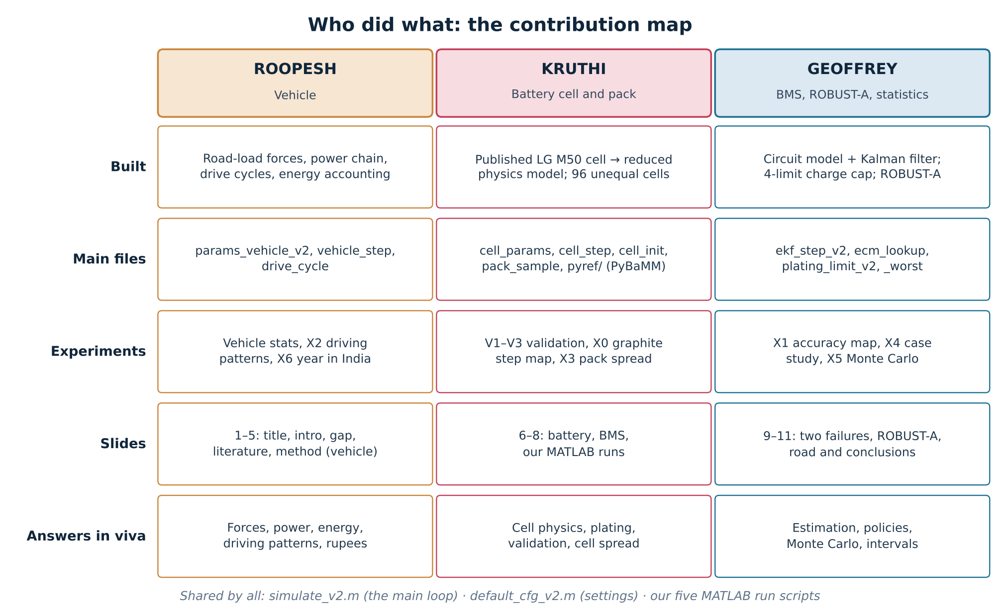

Member	Roll no.	Part
Roopesh Varun	ED26S013	Vehicle model, driving patterns, annual impact for India
Ranganadham Sri Rama Kruthi	ED26E004	Reduced cell model, validation against PyBaMM, pack spread
Geoffrey Simuvwenze	ED25S800	Kalman filter, charge-limit policies, ROBUST-A, Monte Carlo
11. Limitations
This is a simulation study. The cell is a published 5 Ah model scaled to 86 Ah, so the policy rankings are more reliable than the absolute numbers.
Cell-to-cell spreads and ageing laws are assumed typical values. At twice the assumed spread, ROBUST-A also fails in most packs.
Plated lithium is an upper bound, and the reduced model inherits the DFN's omissions (no SEI film resistance or plating feedback).
Results were produced in GNU Octave 8.4. MATLAB and Octave generate different random numbers from the same seed, so single-pack runs differ by a few millivolts. The trends and the Monte Carlo statistics do not change.
12. References
G. L. Plett, "Extended Kalman filtering for battery management systems of LiPB-based HEV battery packs," J. Power Sources, 134(2), 2004.
G. L. Plett, "High-performance battery-pack power estimation using a dynamic cell model," IEEE Trans. Veh. Technol., 53(5), 2004.
C.-H. Chen et al., "Development of experimental techniques for parameterization of multi-scale lithium-ion battery models," J. Electrochem. Soc., 167, 2020.
S. E. J. O'Kane et al., "Lithium-ion battery degradation: how to model it," Phys. Chem. Chem. Phys., 24, 2022.
Y. Cai, Y. Li and T. Wik, "Safety margin for Li-plating-free fast-charging of Li-ion batteries considering parameter uncertainty," IEEE CCTA, 2024.
V. Sulzer et al., "Python Battery Mathematical Modelling (PyBaMM)," J. Open Res. Softw., 9(1), 2021.

The full reference list is in the paper.

MIT Licence, see <a href="LICENSE">LICENSE</a> · © 2026 Roopesh Varun, Ranganadham Sri Rama Kruthi and Geoffrey Simuvwenze

