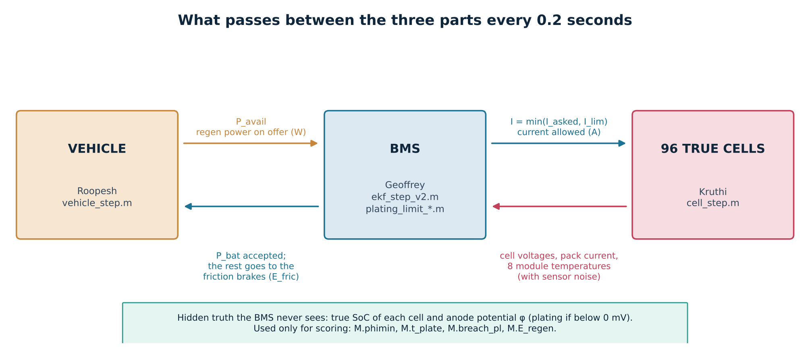
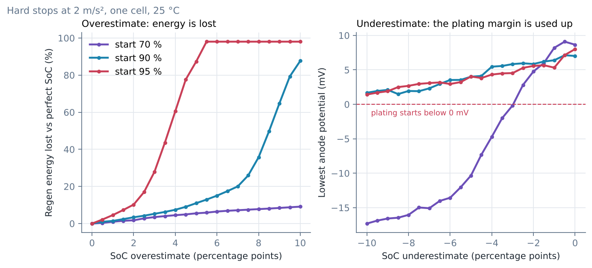
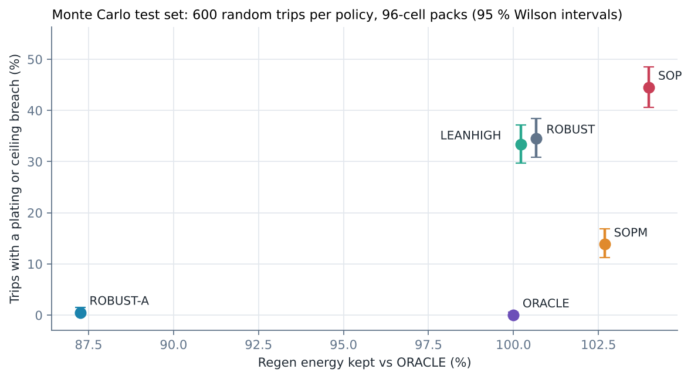

# The Asymmetric Cost of State-of-Charge Error in Regenerative Braking

**Lithium-plating risk in a 96-cell EV pack, and an uncertainty-aware charge limit (ROBUST-A)**

   

Course project for **ED5361 Energy Storage and Conversion Systems**, Department of Engineering Design, IIT Madras (November 2026).

📄 **[Read the paper (IEEE format, 9 pages)](docs/ED5361_IEEE_Report.pdf)** · 📊 **[Presentation slides](docs/ED5361_Presentation.pdf)**

---

## The problem in one paragraph

When an electric car brakes, the motor charges the battery (regenerative braking, "regen"). Every 0.2 s the battery management system (BMS) decides how much charging current to allow. Two of its limits cannot be measured: **lithium plating** (permanent damage when the graphite anode potential falls below 0 V vs Li/Li⁺) and the **97 % state-of-charge ceiling**. Both depend on the *true* state of charge (SoC), but the BMS only has an *estimate*. So the error cuts both ways:

| The SoC estimate reads… | What the BMS does | What it costs |
|---|---|---|
| **too high** | stops regen early | **energy** (goes to the friction brakes) |
| **too low** | allows too much current | **safety** (plating, overfilling) |

This project measures both costs on a physics-based cell model, in a full 96-cell pack, over about 12,000 simulated trips, and proposes a limit that stays safe.



## How we did it

1. **Vehicle** (`core/vehicle_step.m`): a 1,650 kg compact EV, backward-facing model with inertia, air drag, rolling and slope forces; 3 % gear and 8 % motor losses, 60 kW regen cap. Three driving patterns: hard stops, the Indian MIDC city cycle, and a 12 km ghat descent.
2. **Battery cell** (`core/cell_step.m`): the published **LG M50** cell (Chen et al. 2020; O'Kane et al. 2022), reduced from the PyBaMM DFN model to a single-particle model, scaled to 86 Ah. Matches the DFN's lowest anode potential within **3.4 mV** on unseen drive profiles.
3. **Pack** (`core/pack_sample.m`): 96 cells in series, each slightly different (capacity 1 %, resistance 4 %, kinetics 8 %, SoC 1 %, temperature 1.5 K, 1σ).
4. **BMS** (`core/ekf_step_v2.m`, `core/plating_limit_v2.m`): an extended Kalman filter on a 2RC circuit model, and a charge limit that is the smallest of four limits (hardware, voltage, 97 % ceiling, plating) over the next 10 s.
5. **Six limit policies**: SOP (standard), SOPM (fixed 10 mV margin, like industry), ROBUST, LEANHIGH, ORACLE (knows the truth, reference only) and our **ROBUST-A**.
6. **Monte Carlo**: tune on 600 random trips, freeze, then test on **600 unseen trips**, every policy on the same trips.

### ROBUST-A in three lines

```text
SoC used:      z_p = ẑ + k_A·(σ·√max(NIS,1) + 1 %) + Δz_key      (k_A = 3)
Worst cell:    φ_worst = φ_nom − k_c·√(Σ dᵢ²)                     (k_c = 2.5)
Limit:         largest current that keeps φ_worst ≥ 0 mV for the next 10 s
```

It uses **no extra sensors**: the Kalman filter's own consistency check (NIS), the cell-voltage spread at key-on, and the pack's factory spread data.

## Key results

| Finding | Number |
|---|---|
| Overestimate from 95 % SoC (hard stops, 25 °C) | **+2 % → 10 %** of regen lost; **+5 % → 87 %** |
| Plating margin with a perfect estimate | only **4–9 mV** |
| Where accuracy matters | near full **and** at the graphite step (**65–75 % SoC**) |
| Ghat descent, +2 % error from 95 % | **81 %** of regen lost |
| Perfect SoC, unequal cells, standard limit | weakest cell plates in **59–60 of 60** packs |

**Monte Carlo test set (600 unseen trips per policy):**

| Policy | Trips with a breach | 95 % interval | Regen vs ORACLE |
|---|---|---|---|
| SOP (standard) | 44.5 % | 40.6–48.5 % | 104 %* |
| ROBUST | 34.5 % | 30.8–38.4 % | 101 %* |
| LEANHIGH | 33.3 % | 29.7–37.2 % | 100 %* |
| SOPM (industry-style) | 13.8 % | 11.3–16.8 % | 103 %* |
| **ROBUST-A (ours)** | **0.5 %** | **0.2–1.5 %** | **87 %** |

\*Above 100 % means energy accepted while a cell was plating.

**Over a year in India**, ROBUST-A costs about **₹300–430** in lost regen for a private car and about **₹3,390** for a ride-hailing car, while removing almost all plating trips.

| Asymmetry | Safety vs energy |
|---|---|
|  |  |

## How to run

**Requirements:** MATLAB (no toolboxes needed), or GNU Octave 8+. Python 3 with `numpy`, `pandas` and `matplotlib` for the figures; `pybamm` only to regenerate the DFN reference data.

```matlab
% from the repository folder
setup                                   % adds core/ and scripts/ to the path
cfg = default_cfg_v2();                 % default settings
cfg.N = 96;                             % a 96-cell pack
cfg.cycle = 'HILL';                     % 'HARDSTOP', 'MIDC' or 'HILL'
cfg.policy = 'ROBUSTA';                 % 'SOP','SOPM','ROBUST','LEANHIGH','ROBUSTA','ORACLE'
cfg.T_amb_C = 10;                       % ambient temperature (°C)
[M, L] = simulate_v2(cfg);              % M: trip totals, L: time series (if cfg.log = true)
disp([M.E_regen, M.phimin, M.t_plate])  % regen energy, lowest anode potential, seconds plating
% A 96-cell ghat trip takes about 3 minutes in GNU Octave.
```

| To reproduce | Run | Output |
|---|---|---|
| The nine model checks | `scripts/verify_v2.m` | `results/verify_v2.txt` |
| Experiments X0–X5 | `scripts/exp_x0_maps.m` … `scripts/exp_x5_mc.m` | `results/X*.csv` |
| Paper figures | `python3 scripts/make_figures_v2.py` | `results/figures/` |
| Our MATLAB demonstration runs | `scripts/matlab_runs/*.m` (MATLAB only) | CSV, MAT and PNG files in the current folder |

The Monte Carlo study (`exp_x5_mc.m`) takes by far the longest. All saved results are already in `results/`.

## Repository layout

```text
├── core/                 the model: vehicle, cell, pack, BMS, policies, main loop (simulate_v2.m)
├── scripts/              experiments X0–X5, checks, figure scripts
│   └── matlab_runs/      five demonstration scripts run in MATLAB
├── pyref/                PyBaMM DFN reference, model fitting and validation (Python)
├── results/              all result CSVs, key_numbers.json, verify_v2.txt
│   ├── figures/          figures used in the paper
│   └── matlab_runs/      outputs of the MATLAB demonstration runs
├── docs/                 IEEE paper, presentation slides, diagrams
├── setup.m               adds the folders to the MATLAB path
└── LICENSE
```

## Team


| Member | Roll no. | Part |
|---|---|---|
| **Roopesh Varun** | ED26S013 | Vehicle model, driving patterns, annual impact for India |
| **Ranganadham Sri Rama Kruthi** | ED26E004 | Reduced cell model, validation against PyBaMM, pack spread |
| **Geoffrey Simuvwenze** | ED25S800 | Kalman filter, charge-limit policies, ROBUST-A, Monte Carlo |

## Limitations

- This is a **simulation study**. The cell is a published 5 Ah model scaled to 86 Ah, so policy rankings are more reliable than absolute numbers.
- Cell-to-cell spreads and ageing laws are **assumed typical values**. At twice the assumed spread, ROBUST-A also fails in most packs.
- Plated lithium is an upper bound, and the reduced model inherits the DFN's omissions (no SEI film resistance or plating feedback).
- Results were produced in GNU Octave 8.4. MATLAB and Octave generate different random numbers from the same seed, so single-pack runs differ slightly in millivolts; the trends and the Monte Carlo statistics do not change.

## Main references

1. G. L. Plett, "Extended Kalman filtering for battery management systems of LiPB-based HEV battery packs," *J. Power Sources*, 134(2), 2004.
2. G. L. Plett, "High-performance battery-pack power estimation using a dynamic cell model," *IEEE Trans. Veh. Technol.*, 53(5), 2004.
3. C.-H. Chen et al., "Development of experimental techniques for parameterization of multi-scale lithium-ion battery models," *J. Electrochem. Soc.*, 167, 2020.
4. S. E. J. O'Kane et al., "Lithium-ion battery degradation: how to model it," *Phys. Chem. Chem. Phys.*, 24, 2022.
5. Y. Cai, Y. Li and T. Wik, "Safety margin for Li-plating-free fast-charging of Li-ion batteries considering parameter uncertainty," *IEEE CCTA*, 2024.
6. V. Sulzer et al., "Python Battery Mathematical Modelling (PyBaMM)," *J. Open Res. Softw.*, 9(1), 2021.

The full reference list is in the [paper](docs/ED5361_IEEE_Report.pdf).

## Licence

MIT, see [LICENSE](LICENSE).
